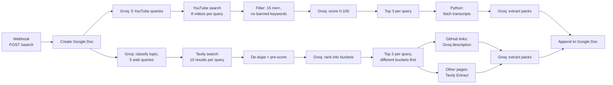
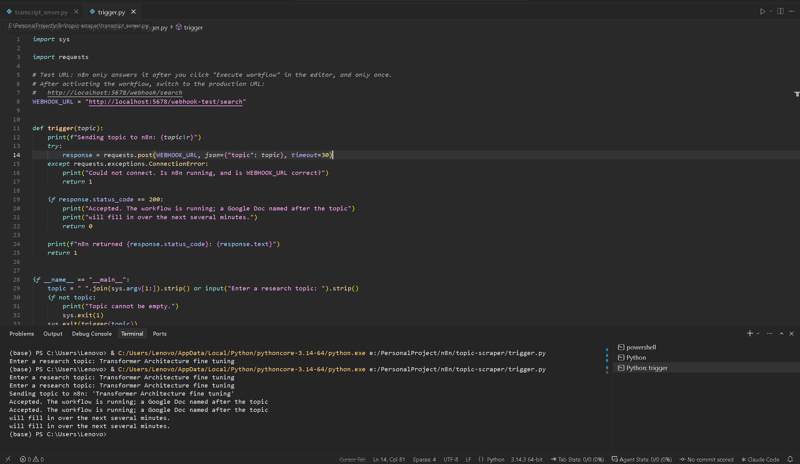

# Topic Scraper

An [n8n](https://n8n.io) workflow that turns a study topic into a research brief. You send it a topic; it searches YouTube and the web, filters and ranks what it finds, reads the best sources (full video transcripts and full page text), and writes a summary of each one into a new Google Doc. You can use RAG like NotebookLLM for supporting your further studies. 


## Example output

| Topic sent | Result |
|---|---|
| Transformer Architecture fine tuning | [Google Doc](https://docs.google.com/document/d/1tBiWvBboDd1dzI4dlnmaBDgQtd6NRzn8VPjw97e2kcw/edit?usp=sharing) (8 videos, 12 web pages) |
| How to implement AdaBoost from scratch | [Google Doc](https://docs.google.com/document/d/1L02Z-YFH6cUe6tWe3gBLbQsDRZFFyAK6gRG7ggeMGZE/edit?usp=sharing) (7 videos, 10 web pages) |

Every searched topic after the filters looks like this (shortened):

```text
Search term: github.com transformer fine tuning example python pytorch
Bucket: THEORY
URL : https://github.com/huggingface/transformers
Tittle : GitHub - huggingface/transformers: 🤗 Transformers
Score: 93.1

Why Selected: Highest relevance score; official repository of the Hugging Face Transformers library ...
Key Takeaway: Official Hugging Face Transformers library repository.; Provides thousands of pretrained models ...
Potential Keyword: Transformers, Hugging Face, pretrained models, NLP, PyTorch, TensorFlow, JAX
```

## Features

- **One request in, one Google Doc out.** A webhook receives `{"topic": "..."}`, creates a Google Doc named after the topic, and fills it in.
- **Two research branches:** YouTube videos and web pages.
- **Queries with different intents.** The model writes 5 YouTube queries and 5 web queries. Each query has its own purpose (lecture, case study, pitfalls, benchmarks, ...), so the results do not all say the same thing.
- **Topic classification.** The topic is put into one of five categories (engineering, coding, math, finance, general), and the web queries follow the template for that category.
- **Rule-based video filter.** Videos shorter than 15 minutes, or with clickbait words in the title or tags, are removed before any model sees them.
- **Scored videos.** A model scores every remaining video from 0 to 100 against a fixed rubric and tags it as lecture, tutorial, news or low value.
- **Real transcripts.** The top videos are summarized from their full transcript, not from the description.
- **Web de-duplication and pre-scoring.** URLs are cleaned of tracking parameters, duplicates are removed, and every page gets a score from fixed rules (domain authority, keyword match, snippet length, paywall).
- **Buckets.** A model sorts each web page into one of seven buckets (theory, implementation, case study, ...) and scores it.
- **Top 3 per query, with variety.** The three best sources for each query are kept, preferring three different buckets and avoiding the same URL or video twice. That is up to 15 videos and 15 web pages per topic.
- **Extract packs.** For each source the model writes why it was selected, the key takeaways and keywords.
- **Bounded request sizes.** Page text and transcripts are cut at 20,000 characters each.
- **Runs with one Docker command,** or with a manual install.
- 
## How it works



Every model step uses `openai/gpt-oss-120b` on Groq. Node names from the canvas are written `like this`.

### The filter system at a glance

| # | Stage | Node | Done by | What it keeps |
|---|---|---|---|---|
| **YouTube** | | | | |
| 1 | Write queries | `Youtube Query1` | Model | 5 queries, one per intent |
| 2 | Search | `Get many videos`, `Youtube GET` | YouTube API | 8 videos per query (40) with length, tags and view counts |
| 3 | Hard filter | `Youtube Filter` | Rules | 15 minutes or longer, no clickbait words |
| 4 | Score | `Reranker YOutube` | Model | Up to 6 scored videos per query |
| 5 | Select | `Top K retrieval yt` | Rules | Top 3 per query, no video twice (up to 15) |
| 6 | Transcript | `Transcript Python`, `Filter` | Python + rules | Only videos that have a transcript |
| 7 | Summarize | `EP Youtube` | Model | One extract pack per video |
| **Web** | | | | |
| 1 | Classify + write queries | `Website Query1` | Model | 1 category, 5 queries, one per intent |
| 2 | Search | `Tavily Search` | Tavily API | 10 results per query (50) |
| 3 | De-dupe + pre-score | `Aggregator (Remove Dupes)` | Rules | Unique URLs, best 12 per query |
| 4 | Rank into buckets | `Reranker Website` | Model | Up to 6 ranked sources per query |
| 5 | Select | `Top K retrieval web` | Rules | Top 3 per query, different buckets first (up to 15) |
| 6 | Read | `If`, `Extract Text`, `Github Repo Extractor1` | Tavily API / model | Page text, cut at 20,000 characters |
| 7 | Summarize | `EP Website` | Model | One extract pack per page |

In the run shown in the screenshot above, the YouTube branch went 40 videos → 23 after the hard filter → 15 selected → 13 with a transcript, and the web branch selected 15 pages (3 GitHub, 12 others).

### YouTube branch in detail

**1. Query intents.** `Youtube Query1` must write five queries, one for each of these:

| Intent |
|---|
| University lecture / academic course |
| Practitioner deep dive / case study |
| Visual intuition / animation |
| Failure modes / mistakes / pitfalls |
| Long-form talk / seminar (30 minutes or more) |

**2. Hard filter.** `Youtube Filter` drops a video when either rule matches:

- **Length:** shorter than 15 minutes (`MIN_DURATION_MINUTES`).
- **Banned keywords** in the title or tags: `reacts`, `reaction`, `reacting`, `reacted`, `trailer`, `teaser`, `short`, `gameplay`, `top 10`, `must watch`, `easiest`. Matching is by whole word, so "reaction" does not block "react" and "top 10" does not block "top 100".

**3. Scoring rubric.** `Reranker YOutube` gives each video a score, a tag (`Lecture`, `Tutorial`, `News` or `LowValue`) and a one-sentence reason:

| Score | Meaning |
|---|---|
| 90–100 | Lecture, conference talk or documentation-style deep dive from a channel with strong authority |
| 70–89 | Solid tutorial or walkthrough with substance |
| 40–69 | News or overview; some value, limited depth |
| 0–39 | Low value, clickbait, reactions |

**4. Selection.** `Top K retrieval yt` sorts each query's videos by score and keeps the top 3. A video already picked for another query is skipped, unless that is the only way to reach 3.

**5. Transcripts.** Videos are sent one at a time to the transcript bridge (see [Files](#files)). Videos with no transcript are dropped. `Cleaner + Parser` removes timestamps and tags and cuts the text at 20,000 characters.

**6. Extract packs.** `EP Youtube` receives all transcripts in one request and writes, per video: why it was selected, key takeaways, claims, steps and keywords (at most 5 bullets each).

### Web branch in detail

**1. Topic category and query intents.** `Website Query1` first writes a short brief of what it already knows and a list of open questions (used only to shape the queries; they are not written to the document). It then picks exactly one category and writes one query per intent of that category:

| Category | Covers | The 5 query intents |
|---|---|---|
| `ENGINEERING` | Hardware, circuits, physics | Theory (PDF / .edu), solved problems, datasheets / app notes, topology comparisons, failure modes |
| `CODING` | Software, ML, algorithms | Docs / papers, "from scratch" code, system design / engineering blogs, benchmarks, anti-patterns |
| `MATH` | Statistics, calculus, proofs | Proofs / theorems, solved practice, real-world applications, visual intuition, common fallacies |
| `FINANCE` | Economics, markets | Definition / formula, Excel models, case studies, risk / drawdowns, data sources |
| `GENERAL` | History, news | Overview, timeline, recent news, critical analysis, myths |

Queries are at most 12 words and may use search operators such as `filetype:pdf`, `site:.edu` or `site:github.com`.

**2. De-duplication.** `Aggregator (Remove Dupes)` rewrites every URL to one standard form before comparing: `https`, no `www.`, no trailing slash, no `#fragment`, and no tracking parameters (`utm_*`, `ref`, `fbclid`, `gclid`, `igshid`). A URL that appears twice for the same query is kept once.

**3. Pre-score (rules only, no model).** Each page gets `score_det`:

```text
score_det = 0.30 × authority + 0.30 × relevance + 0.10 × length − paywall penalty
```

| Part | Value |
|---|---|
| Authority | By domain. `.gov` / `.edu`: 95. arxiv.org, acm.org, ieee.org, nature.com, science.org, openai.com, nvidia.com, cloudflare.com: 90. github.com and `docs.` sites: 75. Everything else: 55. medium.com, substack.com: 45. reddit, tiktok, facebook, instagram: 20. |
| Relevance | 0–100: the share of the query's words (3 letters or more) found in the title, or 70% title + 30% snippet, whichever is higher. |
| Length | By snippet size. Under 250 characters: 15. 250 to 1,199: 70. 1,200 or more: 50. |
| Paywall penalty | 15 points off for ft.com, wsj.com, bloomberg.com, economist.com. |

The best 12 pages per query go on to the model. With the default of 10 search results per query this cuts nothing; it starts to matter if you raise `max_results`.

**4. Buckets.** `Reranker Website` sees each candidate with its pre-score and returns up to 6 ranked sources per query. For each one it sets:

- `quality_score` (0–100): technical authority, depth and usefulness.
- `confidence` (0.0–1.0): how sure the model is that the source is accurate and serious.
- `weighted_score` = `quality_score × confidence`. This is the "Score" in the document.
- Exactly one **bucket**:

| Bucket | Kind of source |
|---|---|
| `THEORY` | Explains the concepts and the reasoning behind them |
| `IMPLEMENTATION` | Shows how to build or code it |
| `CASE_STUDY` | A real use or worked example |
| `COMPARISON` | Compares options, methods or benchmarks |
| `PITFALLS` | Mistakes, failure modes, what to avoid |
| `NEWS` | Recent announcements or coverage |
| `LOW_VALUE` | Thin, promotional or SEO content |

The prompt gives the model the bucket names only; the right-hand column is the plain meaning of each name.

**5. Selection with bucket variety.** `Top K retrieval web` sorts each query's sources by `weighted_score` and fills 3 places in three passes:

1. Take a source only if its URL is unused **and** its bucket is not yet used for this query. This is what makes the three picks cover different angles.
2. If places are left, take any source whose URL is unused.
3. If places are still left, allow a URL that another query already used.

**6. Reading the pages.** The `If` node splits the selected sources by URL:

- **Contains `github.com`:** (For some technology related stuff where Tavily can't access,  `Github Repo Extractor1` writes a one or two sentence description based on the content of the repository.
- **Everything else:** `Extract Text` downloads the page text with Tavily Extract, and `Clean Content` cuts it at 20,000 characters.

**7. Extract packs.** `EP Website` summarizes two pages per request and writes, per page: why it was selected, key takeaways, claims, data points, steps and keywords (at most 6 bullets each). The result is joined back to its bucket and search term by URL.

### What is written to the Google Doc

| Source | Fields |
|---|---|
| Web page | Search term, Bucket, URL, Title, Score (`weighted_score`), Why Selected, Key Takeaway, Potential Keyword |
| Video | URL, Title, Score (0–100 rubric), Why Selected, Key Takeaway, Potential Keyword |

## Files

```text
topic-scraper/
├── FINAL TOPIC SCRAPER.json    the n8n workflow
├── docker-compose.yml          starts n8n and the transcript bridge
├── Dockerfile                  builds the transcript bridge image
├── .env.example                optional Docker settings
├── .dockerignore
├── requirements.txt            Python packages
├── YoutubeTranscript.py        fetches one transcript
├── transcript_server.py        the transcript bridge
├── trigger.py                  sends a topic to the workflow
├── N8N .png                    screenshots used in this README
├── Transcript Server.png
├── Trigger.py.png
├── .gitignore
└── README.md
```

| File | What it does |
|---|---|
| `FINAL TOPIC SCRAPER.json` | The workflow (66 nodes). Import it into n8n. It contains no API keys; nodes only name the n8n credential they expect. |
| `docker-compose.yml` | Defines two containers: `n8n` (the official n8n image, editor on `http://localhost:5678`, data in the `n8n_data` volume) and `transcript` (the bridge below). |
| `Dockerfile` | Builds the `transcript` container: Python 3.12, the packages from `requirements.txt`, and the two transcript scripts. |
| `.env.example` | Optional. Copy to `.env` to pull images through a mirror or to pin the n8n version. Holds no keys. |
| `.dockerignore` | Keeps screenshots, the workflow file and `.env` out of the Docker build. |
| `requirements.txt` | `requests` (for `trigger.py`) and `youtube-transcript-api` 1.x (for `YoutubeTranscript.py`). |
| `YoutubeTranscript.py` | `python YoutubeTranscript.py <video_id>`. Waits a random 15 to 40 seconds, fetches the English transcript, and prints exactly one line of JSON: `{"status": "success", "video_id", "transcript"}` or `{"status": "error", "video_id", "message"}`. |
| `transcript_server.py` | The transcript bridge. n8n cannot run Python, so the `Transcript Python` node calls this small HTTP server instead. `GET /transcript?video_id=<id>` runs `YoutubeTranscript.py` and returns its output; `GET /health` returns `{"status": "ok"}`. Listens on port 8765. |
| `trigger.py` | `python trigger.py "your topic"`. Function `trigger(topic)` posts `{"topic": ...}` to the webhook and reports whether n8n accepted it. With no argument it asks for the topic. |
| `.gitignore` | Keeps `.env`, `cookies.txt` and Python cache files out of git. |

## What you need

Accounts and keys:

| Service | Used for | What to create |
|---|---|---|
| [Groq](https://console.groq.com) | Every model step | An API key |
| [Tavily](https://app.tavily.com) | Web search and page text | An API key (starts with `tvly-`) |
| [Google Cloud](https://console.cloud.google.com) | YouTube search, Google Docs | A project with the **YouTube Data API v3**, **Google Docs API** and **Google Drive API** enabled, and an OAuth client ID (type: Web application) |

You can use local LLLM like Ollama or other LLM API that is supported by N8N, You only need to change raw text of some nodes after the LLM call

## Installation

There are two ways to install this repo:


### Option A: Docker

1. Install [Docker Desktop](https://www.docker.com/products/docker-desktop/) (Windows, macOS) or Docker Engine with the Compose plugin (Linux), and start it.

2. Download or clone this repository and open a terminal in its folder.

3. Start everything:

   ```bash
   docker compose up -d --build
   ```

   The first run downloads the n8n image (large: about 1.8 GB on disk) and builds the bridge. After that it starts in seconds.

4. Check that both containers are running:

   ```bash
   docker compose ps
   ```

   ```bash
   docker compose logs transcript
   ```

   The log should say `Transcript bridge listening on http://0.0.0.0:8765`.

5. Open <http://localhost:5678>. The first time, n8n asks you to create an owner account.


### Option B: Manual

1. Install [Python 3](https://www.python.org/downloads/) (tested with 3.12 and 3.14), then the packages:

   ```bash
   pip install -r requirements.txt
   ```

2. Install and start n8n in one of these ways:

   - With [Node.js](https://nodejs.org) (see [n8n's npm instructions](https://docs.n8n.io/hosting/installation/npm/) for the supported versions):

     ```bash
     npm install -g n8n
     ```

     ```bash
     n8n start
     ```

3. Start the transcript bridge and leave its window open:

   ```bash
   python transcript_server.py
   ```

   

4. Check the address n8n uses to reach the bridge. After importing the workflow (next section), open the `Transcript Python` node:

   | Where n8n runs | URL in the `Transcript Python` node |
   |---|---|
   | Installed with npm | Change it to `http://127.0.0.1:8765/transcript` |
   | Docker Desktop container (Windows, macOS) | Leave it: `http://host.docker.internal:8765/transcript` |

## Set up the workflow in n8n

Do this once, for either option.

1. In n8n, create a new workflow, open the `...` menu at the top right and choose **Import from File**. Pick `FINAL TOPIC SCRAPER.json`.

2. Create your credentials (**Credentials → Add credential**) and select them in the nodes. The nodes show the credential names from the original export until you choose your own:

   | Nodes | Credential type | What to enter |
   |---|---|---|
   | All seven Groq model nodes: `GPT OSS 120B`, `GPT OSS 120B1`, `GPT OSS 120B2`, `GPT OSS 120B3`, `GPT OSS 120B 3`, `GPT OSS 120B 4`, `GPT OSS 120B 5` | Groq API | Your Groq key |
   | `Tavily Search`, `Extract Text` | Bearer Auth | Your Tavily key as the token. Enter only the key, without the word "Bearer". |
   | `Create a document`, `Final Document`, `Final Document1` | Google Docs OAuth2 API | Client ID and secret of your Google OAuth client |
   | `Get many videos` | YouTube OAuth2 API | The same client ID and secret |
   | `Youtube GET` | OAuth2 API (generic) | See below |

3. For the Google credentials, n8n shows an **OAuth Redirect URL** in the credential window. Copy it into your Google OAuth client under **Authorized redirect URIs**, then click **Sign in with Google**. While your Google app is in "Testing" mode, add your own Google account as a test user.

4. `Youtube GET` uses the generic OAuth2 credential type. Fill it in like this:

   | Field | Value |
   |---|---|
   | Grant Type | Authorization Code |
   | Authorization URL | `https://accounts.google.com/o/oauth2/v2/auth` |
   | Access Token URL | `https://oauth2.googleapis.com/token` |
   | Client ID / Client Secret | From your Google OAuth client |
   | Scope | `https://www.googleapis.com/auth/youtube.readonly` |
   | Auth URI Query Parameters | `access_type=offline&prompt=consent` |

5. Save the workflow.

## Running it

1. Make sure the transcript bridge is running (Option A: it already is; Option B: you need to run `python transcript_server.py`).

2. In the n8n editor, click **Execute workflow**. n8n now waits for one request.

3. Send a topic.

   With Python:

   ```bash
   python trigger.py "Kalman filter"
   ```

   

   Without Python, on macOS or Linux:

   ```bash
   curl -X POST http://localhost:5678/webhook-test/search -H "Content-Type: application/json" -d '{"topic": "Kalman filter"}'
   ```

   Without Python, in Windows PowerShell:

   ```powershell
   Invoke-RestMethod -Method Post -Uri http://localhost:5678/webhook-test/search -ContentType "application/json" -Body '{"topic": "Kalman filter"}'
   ```

4. Open Google Drive. A document named after your topic is already there, empty. n8n runs the YouTube branch first and the web branch after it, so the video summaries appear first and the web summaries follow. In a test run of "Transformer Architecture fine tuning" the whole thing took 8.8 minutes: about 8 for the YouTube branch (mostly the waiting between transcripts) and 1 for the web branch.

`/webhook-test/search` is n8n's test address: it answers once after each click of **Execute workflow**. To run without clicking, activate (publish) the workflow and use `http://localhost:5678/webhook/search` instead. In `trigger.py` that is the `WEBHOOK_URL` line.


## Things to know

- **Transcripts are slow on purpose.** `YoutubeTranscript.py` waits a random 15 to 40 seconds before each request so YouTube does not block your IP address. For 15 videos that is about 4 to 10 minutes. Do not remove the delay.
- **Transcripts are English only.** Videos without English captions are skipped, not treated as errors.
- **The Token consumption is quite large.** The single transcript request can reach about 75,000 tokens (15 transcripts of 20,000 characters), and each web summary request about 10,000. (~0.05 USD per topic)
- **Keep "Maximum Number of Tokens" set on the Groq nodes.** Without it Groq stops the reply early, the JSON is cut off, and the next Code node fails.
- **The model must answer in JSON.** Each ranking and summary step parses the model's reply as JSON. If a reply is malformed, the step either stops the run or drops that source. A few error messages in the Code nodes still say "Gemini" (for example "Failed to parse Gemini JSON"); they come from an earlier version of the workflow, and the model they refer to is the Groq one.
- **Tested with** n8n 2.42.6 on Windows with Docker Desktop. Option B (n8n in a container, bridge started by hand) has done full runs. For Option A, the containers were started, the workflow was imported, and n8n fetched a real transcript through the bridge.
